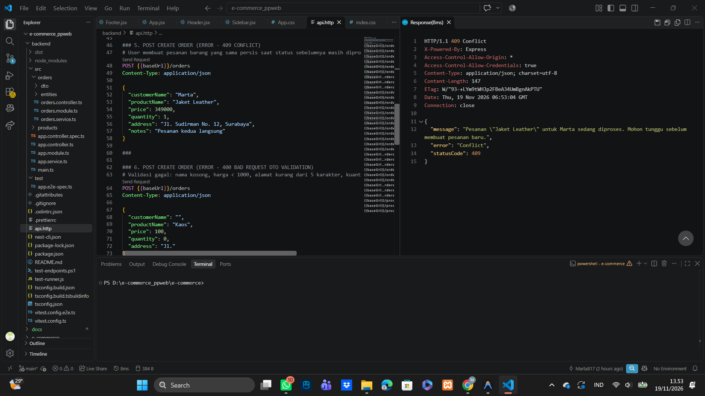
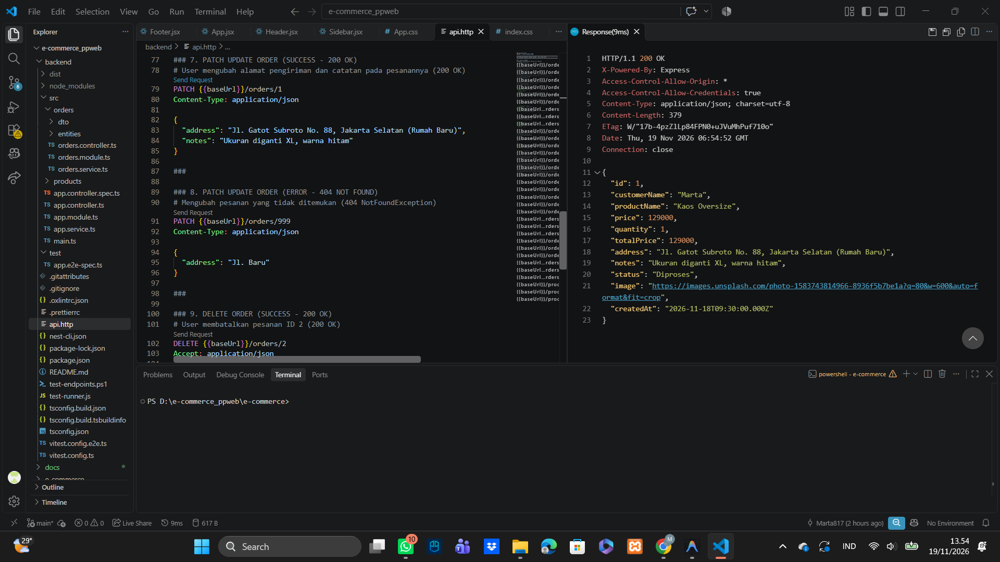

# Tugas Pekan 3 - Backend NestJS (Storeku E-Commerce)

Repository ini merupakan lanjutan dari proyek tugas pekan 2 (aplikasi web e-commerce pribadi **Storeku**). Pada pekan ini, saya mengimplementasikan fondasi backend menggunakan **NestJS** dengan pola arsitektur MVC (Model-View-Controller) dan menghubungkannya langsung ke frontend React yang sudah dibuat sebelumnya.

---

## 👤 Identitas Mahasiswa
- **Nama** : [Nama Lengkap Mahasiswa]
- **NIM** : [NIM Mahasiswa]
- **Kelas** : [Kelas / Paralel]
- **Mata Kuliah** : Pengembangan Aplikasi Web / Praktikum Pemrograman Web

---

## 📌 Deskripsi Singkat Proyek
Aplikasi **Storeku** adalah aplikasi web toko online untuk produk fashion dan lifestyle (pakaian, sepatu, tas, aksesoris). Pada tugas pekan ini:
- Backend dibangun dengan framework **NestJS**.
- Data utama yang dikelola adalah **Produk (`Product`)**.
- Data sementara disimpan di dalam memori (**in-memory array**) pada Service.
- Seluruh endpoint diuji menggunakan **REST Client** (`api.http`).
- Frontend React sudah terhubung ke backend NestJS dengan alur CRUD penuh (menampilkan, menambah, mengubah, dan menghapus produk).

---

## 🛠️ Rincian Pengerjaan Tugas

### 1. Data Utama Aplikasi
Data utama yang saya gunakan adalah **Produk**. Entitas `Product` memiliki 9 atribut dengan tipe data yang bervariasi:
- `id` (`number`): ID unik produk.
- `name` (`string`): Nama produk.
- `price` (`number`): Harga produk dalam Rupiah.
- `category` (`string`): Kategori barang (`Pakaian`, `Outerwear`, `Sepatu`, `Tas`, `Aksesori`).
- `stock` (`number`): Jumlah stok barang.
- `description` (`string`): Keterangan/deskripsi produk.
- `isAvailable` (`boolean`): Status apakah produk tersedia atau habis.
- `image` (`string`): Link URL foto produk.
- `createdAt` (`Date`): Waktu barang ditambahkan.

### 2. Nest Resource & Struktur Entity
Resource digenerate menggunakan command Nest CLI:
```bash
nest g resource products
```
File entity berada di `backend/src/products/entities/product.entity.ts`.

### 3. Operasi CRUD pada Service (In-Memory Array)
File service berada di `backend/src/products/products.service.ts`. Data produk disimpan di dalam array `private products: Product[] = [...]`. Operasi yang diimplementasikan:
- `create()` : Menambah produk baru ke array.
- `findAll()` : Menampilkan semua daftar produk.
- `findOne()` : Menampilkan detail satu produk berdasarkan ID.
- `update()` : Mengubah data produk tertentu.
- `remove()` : Menghapus produk dari array berdasarkan ID.

### 4. Controller & Dependency Injection
File controller berada di `backend/src/products/products.controller.ts`. Controller memanggil `ProductsService` lewat Dependency Injection di constructor:
```typescript
constructor(private readonly productsService: ProductsService) {}
```
Method HTTP yang digunakan:
- `GET /products` ➔ memanggil `findAll()`
- `GET /products/:id` ➔ memanggil `findOne()`
- `POST /products` ➔ memanggil `create()`
- `PATCH /products/:id` ➔ memanggil `update()`
- `DELETE /products/:id` ➔ memanggil `remove()`

### 5. Validasi DTO & Global ValidationPipe
Validasi dibuat di `backend/src/products/dto/create-product.dto.ts` menggunakan library `class-validator`:
- `@IsNotEmpty()`, `@IsString()`, `@MinLength(3)` untuk nama produk.
- `@IsNotEmpty()`, `@IsNumber()`, `@Min(1000)` untuk harga minimal Rp 1.000.
- `@IsIn(['Pakaian', 'Outerwear', 'Sepatu', 'Tas', 'Aksesori'])` untuk memastikan kategori valid.
- `@IsInt()`, `@Min(0)` untuk validasi stok barang tidak boleh minus.
- `@IsOptional()`, `@IsBoolean()` untuk status ketersediaan.

`ValidationPipe` diaktifkan secara global di file `backend/src/main.ts`:
```typescript
app.useGlobalPipes(
  new ValidationPipe({
    whitelist: true,
    forbidNonWhitelisted: true,
    transform: true,
  }),
);
```

### 6. Penanganan Error (Exception NestJS)
Saya menerapkan minimal 2 skenario error bawaan NestJS:
1. **`NotFoundException` (404)**: Dijalankan ketika user mencari, mengupdate, atau menghapus produk dengan ID yang tidak ada di memori.
2. **`ConflictException` (409)**: Dijalankan ketika user mencoba menambah produk baru dengan nama yang sudah terdaftar (duplikat).
3. **`BadRequestException` (400)**: Otomatis dimunculkan oleh ValidationPipe saat input request body tidak sesuai aturan DTO.

---

## 💻 Cara Menjalankan Proyek

### 1. Jalankan Backend (NestJS)
```bash
cd backend
npm install
npm run start:dev
```
Backend berjalan di: `http://localhost:3000`

### 2. Jalankan Frontend (React Vite)
Buka terminal baru:
```bash
cd e-commerce
npm install
npm run dev
```
Frontend berjalan di: `http://localhost:5173`

---

## 🧪 Pengujian REST API (REST Client)

Seluruh endpoint diuji menggunakan file `api.http` (bisa dibuka langsung di VS Code menggunakan extension REST Client).

Skenario pengujian yang tersedia:
1. `GET /products` (Ambil semua produk - 200 OK)
2. `GET /products/1` (Ambil detail produk ID 1 - 200 OK)
3. `GET /products/999` (ID tidak ditemukan - 404 NotFoundException)
4. `POST /products` (Tambah produk baru - 201 Created)
5. `POST /products` (Nama produk kembar - 409 ConflictException)
6. `POST /products` (Validasi DTO gagal - 400 Bad Request)
7. `PATCH /products/1` (Update data produk - 200 OK)
8. `PATCH /products/999` (Update ID tidak ada - 404 NotFoundException)
9. `DELETE /products/2` (Hapus produk ID 2 - 200 OK)
10. `DELETE /products/999` (Hapus ID tidak ada - 404 NotFoundException)

---

## 📷 Dokumentasi Screenshot Pengujian

Screenshot pengujian disimpan di folder `docs/screenshots/`:

### A. Pengujian Backend (REST Client)
1. **GET All Products (200 OK)**  
   

2. **GET Product by ID (200 OK)**  
   

3. **GET Product Not Found (404 NotFoundException)**  
   

4. **POST Create Product (201 Created)**  
   

5. **POST Duplicate Conflict (409 ConflictException)**  
   

6. **POST Validation Error (400 Bad Request)**  
   

7. **PATCH Update Product (200 OK)**  
   

8. **DELETE Remove Product (200 OK)**  
   

### B. Integrasi Frontend (Storeku)
1. **Menu Kelola Produk (Koneksi Backend Aktif)**  
   

2. **Form Modal Tambah Produk**  
   

3. **Form Modal Edit Produk**  
   

4. **Hapus Data Produk & Feedback Berhasil**  
   
