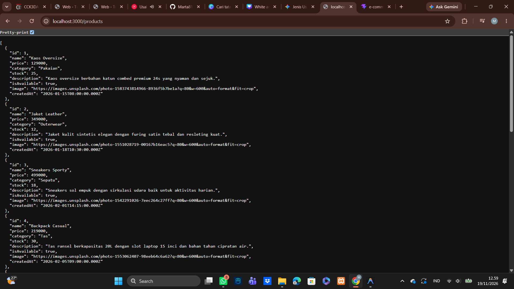
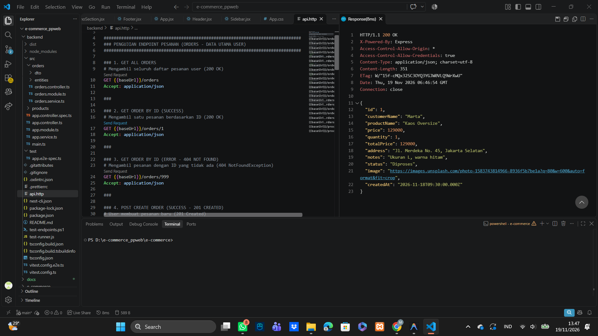
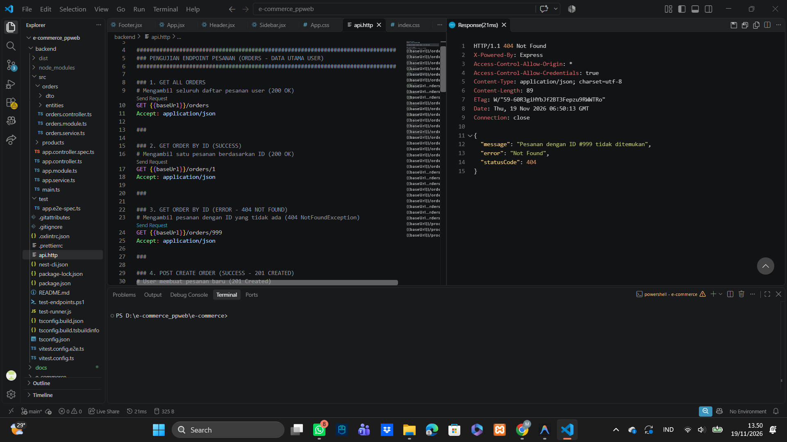
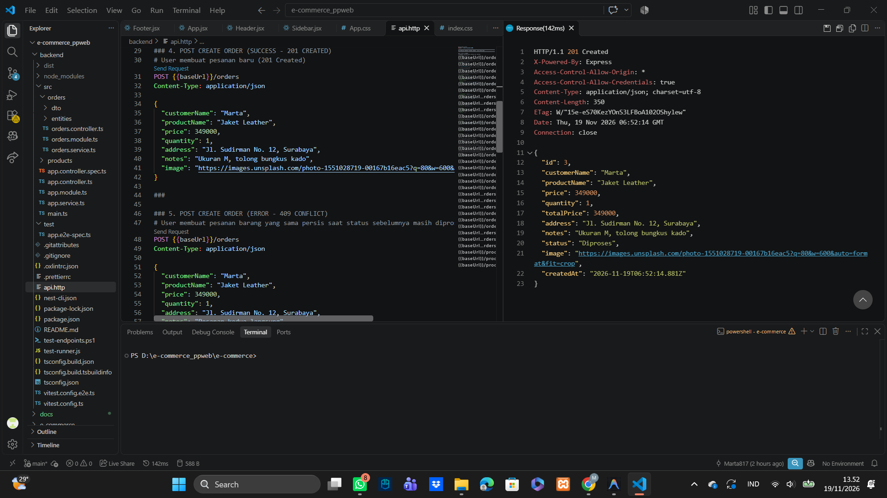
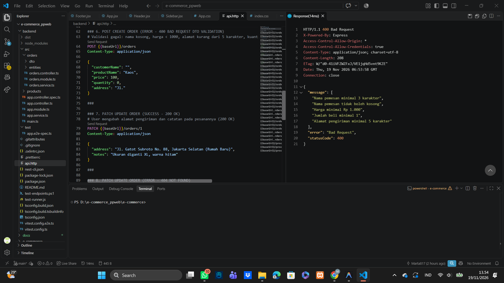
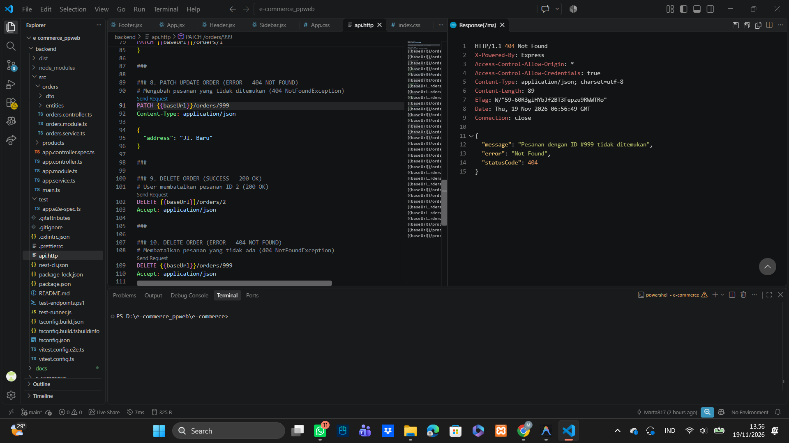
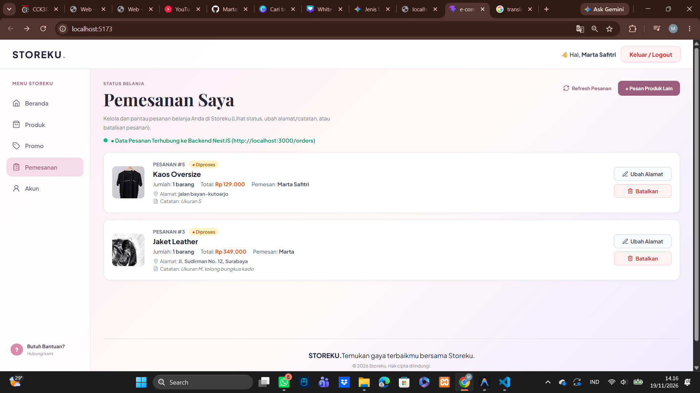
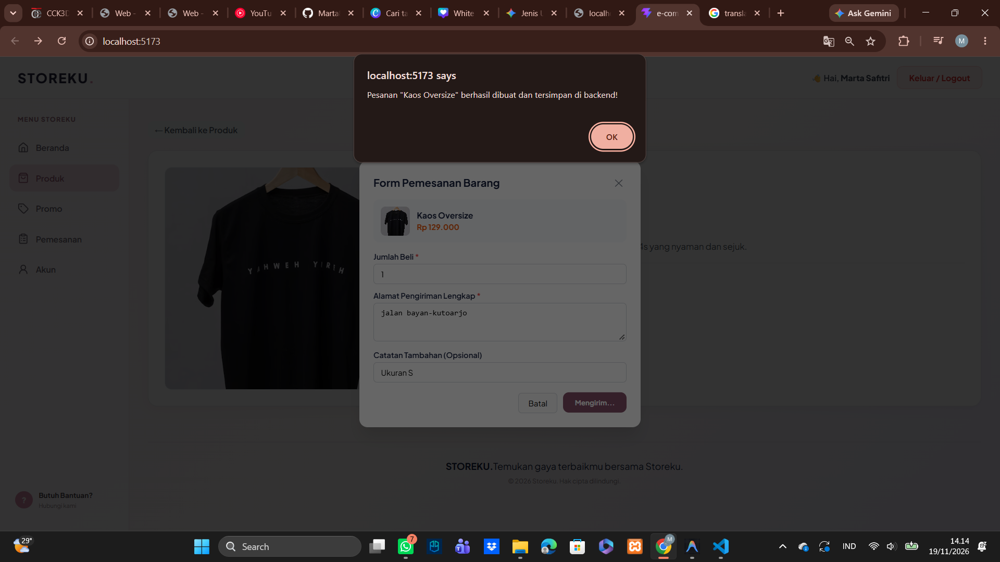
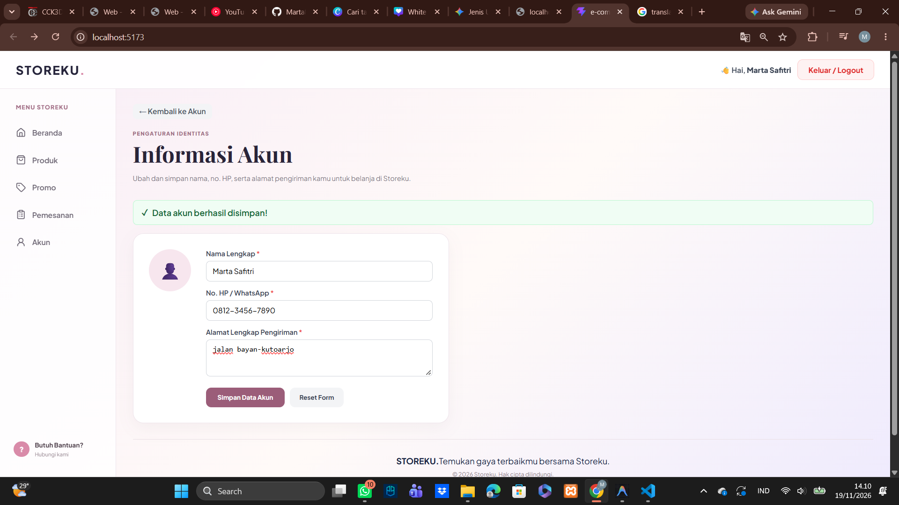
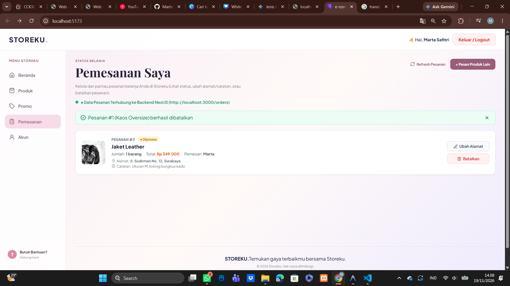

# Tugas Praktikum Pengembangan Aplikasi Web - Pekan 3

Repository ini berisi tugas pekan 3 kelanjutan dari aplikasi **Storeku** (aplikasi e-commerce pribadi dari tugas pekan 2). Di pekan ini, fokus pengerjaannya adalah membangun backend menggunakan **NestJS** dengan struktur MVC dan menghubungkannya ke frontend React.

### Identitas
- **Nama**: Marta
- **NIM**: [Isi NIM]
- **Kelas**: [Isi Kelas]

---

## Penjelasan Singkat Aplikasi
Storeku adalah web e-commerce untuk toko fashion dan lifestyle. Pada tugas pekan ini, backend NestJS dibangun untuk mengelola data utama aktivitas pembeli yaitu **Pesanan (`Order`)**. Seluruh data disimpan sementara di memori backend (in-memory array pada service) dan sudah terhubung langsung ke tampilan frontend:
- User bisa memesan produk langsung dari katalog toko.
- Di menu **Pemesanan**, user bisa melihat riwayat pesanan, mengedit alamat/catatan, atau membatalkan pesanan.

---

## Poin-Poin Pengerjaan Tugas

1. **Data Utama (`Order`)**  
   Data utama yang dikelola pembeli adalah Pesanan (`Order`). Entitas dibuat di `backend/src/orders/entities/order.entity.ts` dengan total 11 atribut:
   - `id` (number): ID pesanan unik.
   - `customerName` (string): Nama pemesan.
   - `productName` (string): Nama produk yang dibeli.
   - `price` (number): Harga satuan produk.
   - `quantity` (number): Jumlah barang yang dipesan.
   - `totalPrice` (number): Total harga belanja.
   - `address` (string): Alamat pengiriman barang.
   - `notes` (string, opsional): Catatan pesanan (ukuran/warna).
   - `status` (string): Status pesanan (`Diproses`, `Dikirim`, `Selesai`, `Dibatalkan`).
   - `image` (string, opsional): URL foto produk.
   - `createdAt` (Date): Waktu pesanan dibuat.

2. **Resource NestJS**  
   Dibuat menggunakan Nest CLI:
   ```bash
   nest g resource orders
   ```
   File otomatis terbuat di folder `backend/src/orders/`.

3. **Service CRUD (In-Memory)**  
   Implementasi ada di `backend/src/orders/orders.service.ts`. Data disimpan dalam array `private orders: Order[]` dengan fungsi CRUD lengkap:
   - `create`: Menambahkan pesanan baru ke antrean (ID, total harga, dan createdAt otomatis dibuat).
   - `findAll`: Mengambil semua daftar pesanan pembeli.
   - `findOne`: Mengambil 1 pesanan berdasarkan ID.
   - `update`: Mengubah alamat pengiriman atau catatan pesanan.
   - `remove`: Membatalkan / menghapus pesanan dari array.

4. **Controller & Dependency Injection**  
   Implementasi ada di `backend/src/orders/orders.controller.ts`. Service di-inject langsung melalui constructor (`constructor(private readonly ordersService: OrdersService) {}`) tanpa membuat instance manual. Menggunakan method:
   - `GET /orders`
   - `GET /orders/:id` (dengan `ParseIntPipe`)
   - `POST /orders`
   - `PATCH /orders/:id`
   - `DELETE /orders/:id`

5. **DTO & Validasi (class-validator)**  
   DTO dibuat di `backend/src/orders/dto/create-order.dto.ts` dan `update-order.dto.ts`. Validasi yang digunakan:
   - `@IsNotEmpty()`, `@IsString()`, `@MinLength(3)` untuk nama pemesan.
   - `@IsNotEmpty()`, `@IsString()` untuk nama produk.
   - `@IsNotEmpty()`, `@IsNumber()`, `@Min(1000)` untuk harga minimal Rp 1.000.
   - `@IsNotEmpty()`, `@IsInt()`, `@Min(1)` untuk jumlah beli minimal 1 barang.
   - `@IsNotEmpty()`, `@IsString()`, `@MinLength(5)` untuk alamat pengiriman minimal 5 karakter.
   - `@IsOptional()`, `@IsIn(['Diproses', 'Dikirim', 'Selesai', 'Dibatalkan'])` untuk status pesanan.
   
   ValidationPipe diaktifkan secara global di `backend/src/main.ts`:
   ```typescript
   app.useGlobalPipes(
     new ValidationPipe({
       whitelist: true,
       forbidNonWhitelisted: true,
       transform: true,
     }),
   );
   ```

6. **Error Handling (Exception Bawaan NestJS)**  
   Menangani error menggunakan:
   - `NotFoundException` (404): Muncul saat mencari, mengedit alamat, atau membatalkan pesanan dengan ID yang tidak ada.
   - `ConflictException` (409): Muncul saat user memesan barang yang sama persis dalam status yang masih diproses (mencegah double order).
   - `BadRequestException` (400): Muncul otomatis dari ValidationPipe jika isi body request tidak sesuai aturan DTO.

7. **Testing REST Client**  
   Seluruh endpoint sudah dites menggunakan file `api.http` di root proyek. Ada 10 skenario request (sukses dan error) yang sudah diuji.

8. **Integrasi Frontend & Backend (Alur Murni User)**  
   - Backend sudah mengaktifkan CORS (`app.enableCors()`).
   - Menu website tetap original (Beranda, Produk, Promo, Pemesanan, Akun) murni untuk pembeli.
   - Alur CRUD penuh:
     - **Tambah (POST)**: User buka detail produk di katalog ➔ klik *"Pesan Produk Sekarang"* ➔ isi alamat ➔ pesanan tersimpan ke backend.
     - **Lihat (GET)**: Masuk ke menu *"Pemesanan"* ➔ data pesanan ditarik dari backend NestJS (`/orders`).
     - **Ubah (PATCH)**: Di menu *"Pemesanan"*, user bisa klik *"Ubah Alamat"* untuk memperbarui alamat pengiriman.
     - **Hapus (DELETE)**: Di menu *"Pemesanan"*, user bisa klik *"Batalkan"* untuk menghapus pesanan.

---

## Cara Menjalankan Proyek

### 1. Jalankan Backend
Buka terminal:
```bash
cd backend
npm install
npm run dev
```
Backend jalan di port 3000 (`http://localhost:3000`).

### 2. Jalankan Frontend
Buka terminal baru:
```bash
cd e-commerce
npm install
npm run dev
```
Buka browser di `http://localhost:5173`. Masuk ke menu **Pemesanan** di sidebar kiri.

---

## Screenshot Pengujian

Screenshot pengujian disimpan di folder `docs/screenshots/`:

### 1. REST Client (Backend)

- **GET All Orders (200 OK)**  
  

- **GET Order by ID (200 OK)**  
  

- **GET Order by ID - Not Found (404)**  
  

- **POST Create Order (201 Created)**  
  

- **POST Create - Conflict Double Order (409)**  
  

- **POST Create - Validasi DTO Gagal (400 Bad Request)**  
  

- **PATCH Update Order Alamat (200 OK)**  
  

- **DELETE Order Batalkan (200 OK)**  
  

### 2. Tampilan Frontend

- **Halaman Pemesanan (Terkoneksi Backend)**  
  

- **Modal Form Pemesanan Baru (POST)**  
  

- **Modal Form Ubah Alamat Pesanan (PATCH)**  
  

- **Konfirmasi Batalkan Pesanan (DELETE)**  
  
