# Dokumentasi Screenshot Pengujian Tugas (Pekan 3)

Dokumentasi ini berisi bukti pengujian endpoint REST API backend (NestJS) menggunakan REST Client (`api.http`) serta bukti alur CRUD pada tampilan frontend:

---

## 1. REST Client Backend (NestJS)

### 1. GET Seluruh Pesanan (200 OK)
Mengambil seluruh daftar pesanan pembeli (`GET /orders`).
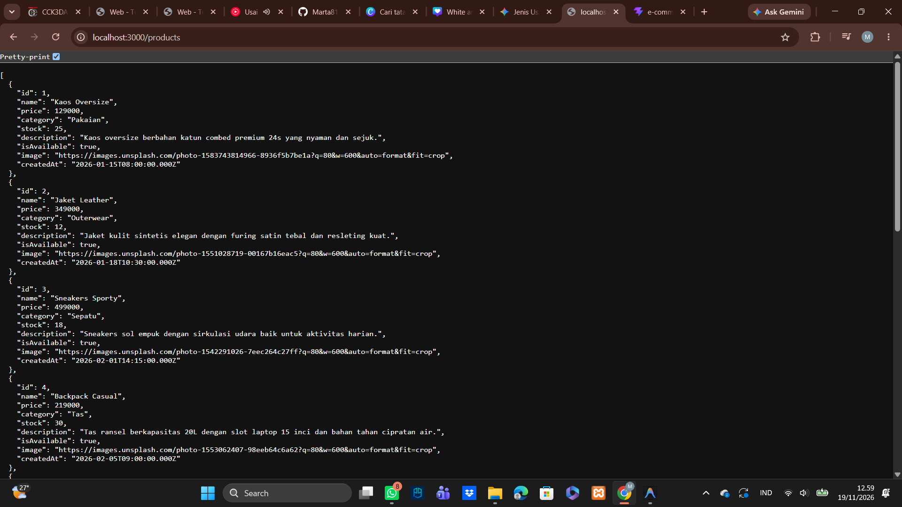

---

### 2. GET Pesanan Berdasarkan ID (200 OK)
Mengambil detail satu pesanan berdasarkan ID yang valid (`GET /orders/1`).
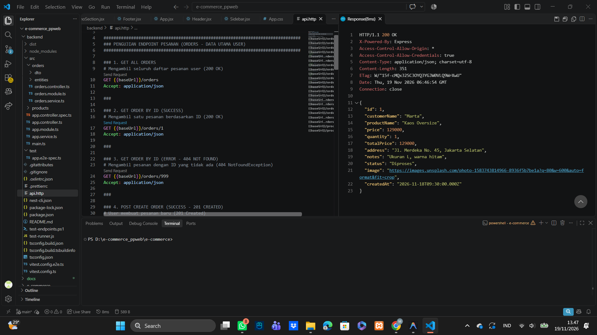

---

### 3. GET Pesanan Not Found (404 Not Found)
Mengambil pesanan dengan ID yang tidak terdaftar (`GET /orders/999`), memicu `NotFoundException`.
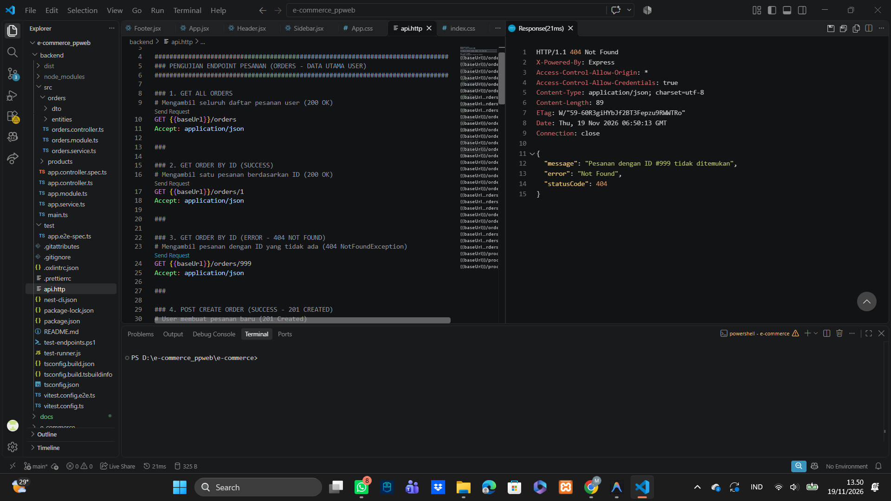

---

### 4. POST Buat Pesanan Baru (201 Created)
User berhasil membuat pesanan baru (`POST /orders`).
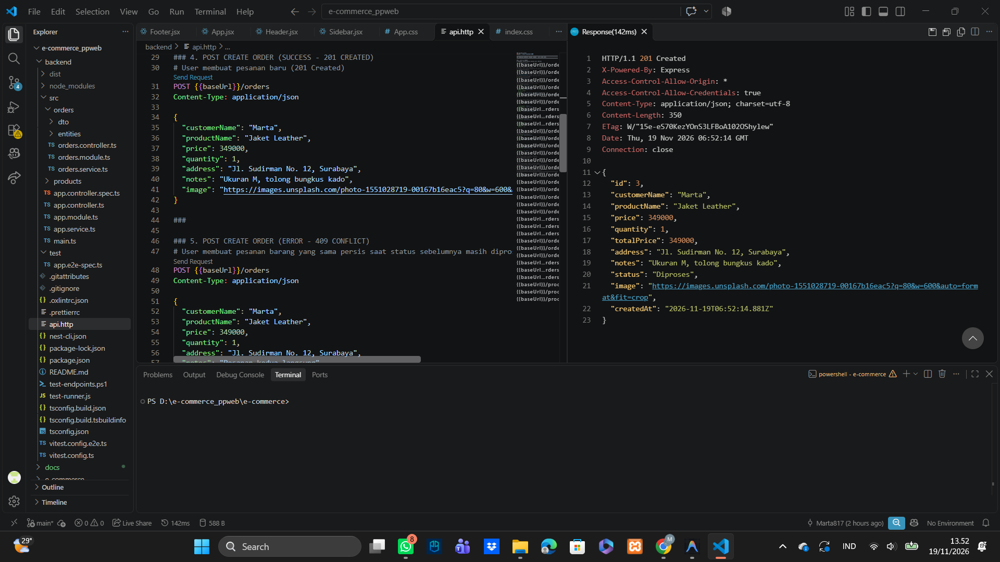

---

### 5. POST Pesanan Duplikat (409 Conflict)
User mencoba memesan barang yang sama saat pesanan sebelumnya masih diproses, memicu `ConflictException`.
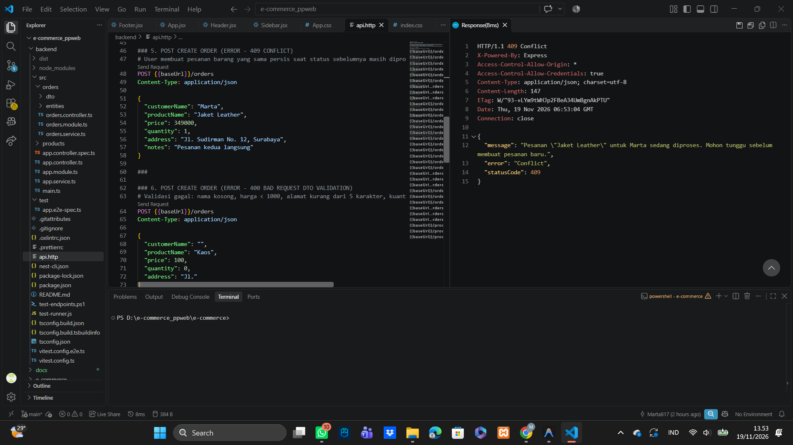

---

### 6. POST Validasi DTO Gagal (400 Bad Request)
User mengirim data pesanan kosong/tidak valid, memicu `ValidationPipe` (nama kosong, harga < 1000, alamat < 5 karakter).
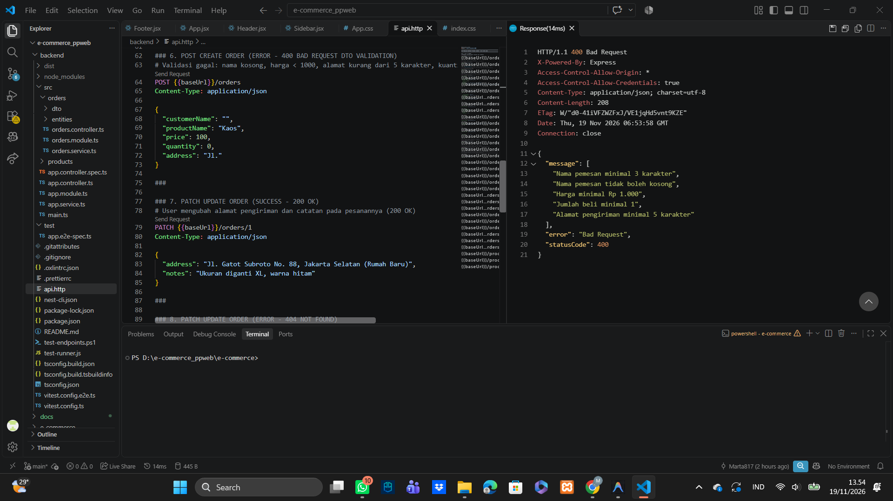

---

### 7. PATCH Update Alamat & Catatan Pesanan (200 OK)
User memperbarui alamat pengiriman dan catatan pada pesanannya (`PATCH /orders/1`).
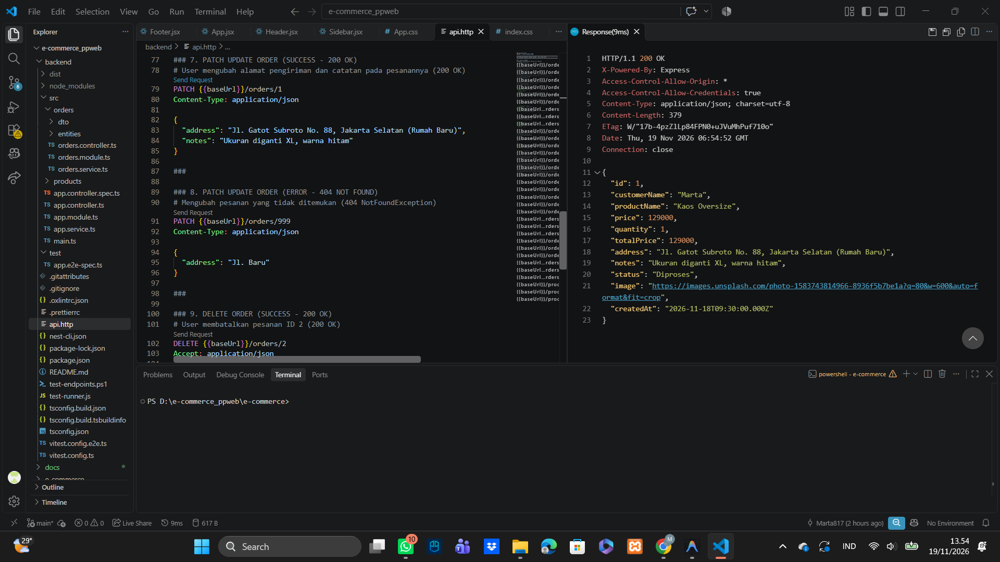

---

### 8. DELETE Batalkan Pesanan (200 OK)
User membatalkan pesanannya (`DELETE /orders/2`).
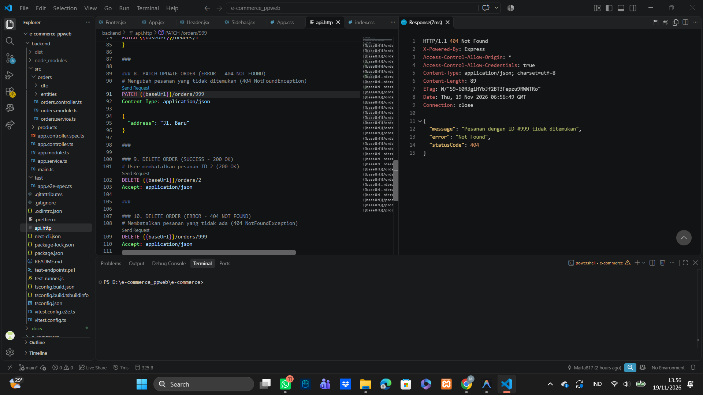

---

## 2. Tampilan Frontend

### 9. Halaman Menu Pemesanan
Menampilkan daftar pesanan yang ditarik langsung dari backend NestJS (`GET /orders`).
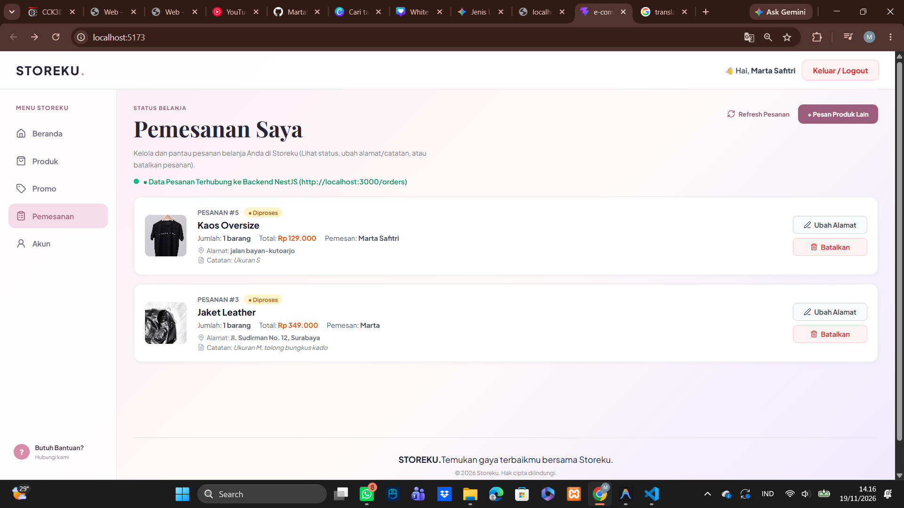

---

### 10. Form Pesan Produk Baru (Checkout Modal)
Form pemesanan saat user mengklik "Beli Sekarang" dari katalog produk (`POST /orders`).
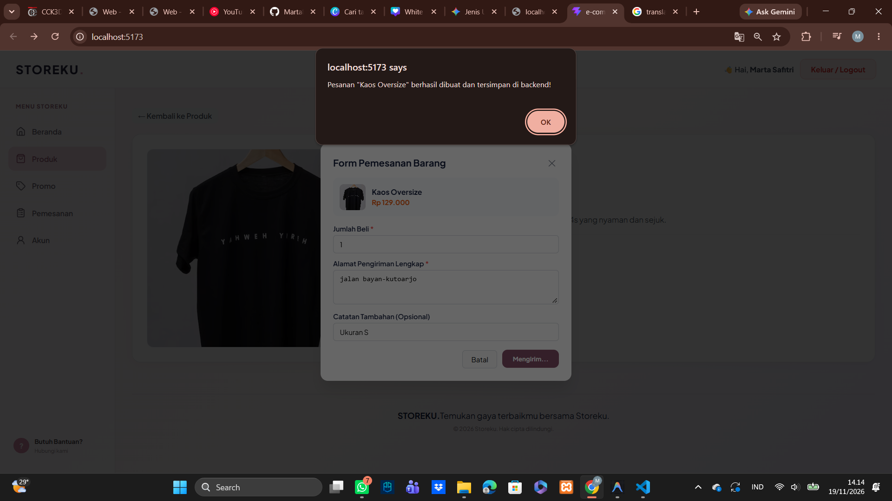

---

### 11. Form Ubah Alamat / Catatan Pesanan
Modal interaktif untuk memperbarui alamat pengiriman (`PATCH /orders/:id`).
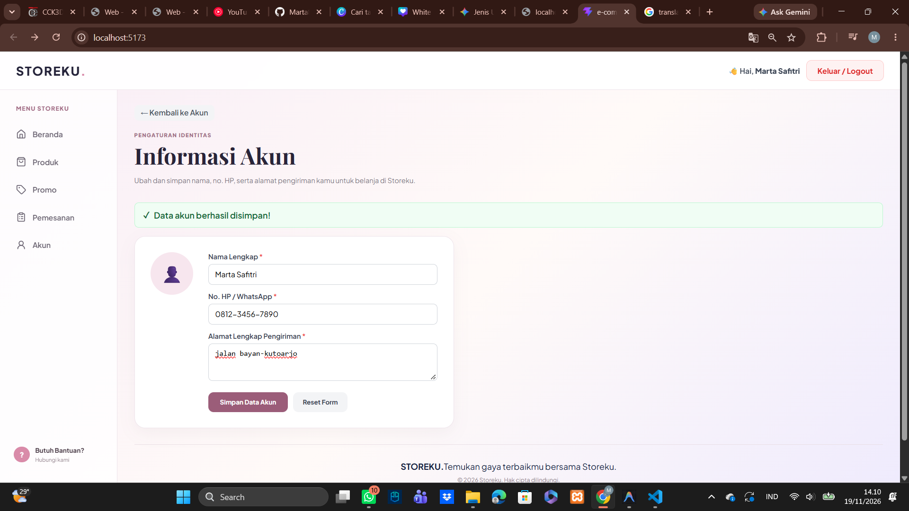

---

### 12. Konfirmasi Pembatalan Pesanan
Modal konfirmasi saat user membatalkan pesanan (`DELETE /orders/:id`).
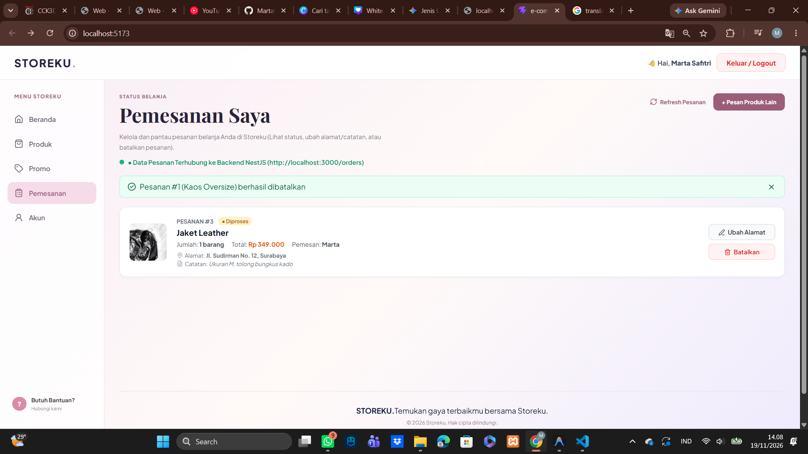

